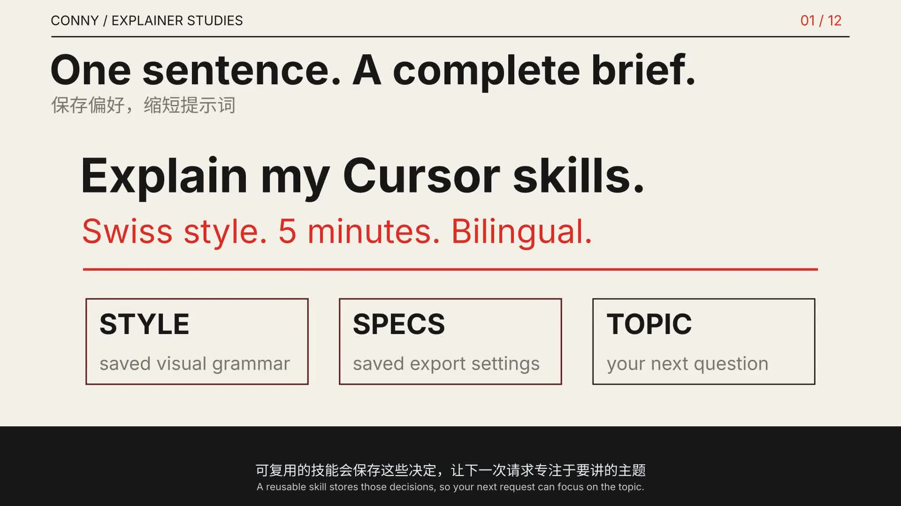

# Conny's video incubator

A shared workspace for turning ideas, papers, code and workflows into narrated explainer videos.
Keep the evidence, reusable styles, production tools and editable episode sources together so
Codex, Cursor, Claude Code or another agent can pick up the same work.

**Start here:** [Watch/download videos](docs/VIDEOS.md) · [Make a video](docs/VIDEO-WORKFLOW.md) ·
[Choose a style](docs/STYLES.md) · [Add or refine a style](docs/STYLE-LIFECYCLE.md)

[](https://github.com/JunyiZhou-Conny/Explainer_Videos/releases/download/incubator-2026-10-12/skills-ecosystem.mp4)

## What should I type?

Open this repository in your agent and paste:

> Read AGENTS.md and use this repository's conny-explainer-video skill. Explain **Git branches**
> for **a beginner who can already commit**. Use **nasa-punk** and saved production defaults.
> Use **the attached demo repository** as evidence. Show one change on two branches and a merge.
> Build a representative narrated sample, fix any issues, then finish the video with bilingual
> captions, editable source and review notes.

Usually you only need **the idea, the audience, the source material, and a style name**.
Defaults for new episodes are **five minutes, 1080p30, English narration, Chinese above English
subtitles, 3b1b style** (Swiss until 2026-10-30). An explicit request overrides those defaults for that episode.
You do not need to repeat a long style paragraph. [More prompts and input examples](docs/VIDEO-WORKFLOW.md).

To add a style:

> Study these reference links, especially the timestamped moments I marked. Create an original
> preset called `my-new-style`, describe the composition and motion rules, and test it with a
> 20–30 second narrated sample. Save the source links and observations. Keep my default unchanged.

To improve one:

> Refine `swiss`: at 01:20 in the latest episode, path labels are too small and the fades feel
> disconnected. Demonstrate clearer labels and connected transformations on one scene, then
> save the successful rules in the shared preset. Keep the original render available.

[Style ingestion and refinement guide](docs/STYLE-LIFECYCLE.md) explains what to observe,
what to save, how to review samples and how to version changes.

## Styles and implementation status

| Preset | Main idea | Current evidence |
| --- | --- | --- |
| `3b1b` | Dark mathematical diagrams; picture before formula; semantic colors | Existing toolkit and completed math episodes preserved |
| `swiss` | Strong grid, clear type, cream/black/red editorial diagrams | Complete five-minute skills episode; technical and sampled-frame checks |
| `cassette-futurism` | CRTs, physical controls and meaningful equipment states | Reusable design specification; representative render pending |
| `de-stijl` | Orthogonal planes, primary colors and structural relationships | Design specification; representative render pending |
| `bauhaus` | Geometric construction or Dessau-inspired typography | Design specification; representative render pending |
| `nasa-punk` | Starfield-inspired functional aerospace panels and labels | Design specification; representative render pending |
| `rhine-lab` | Warm glass archives, selection and layered inspection | Design specification; representative render pending |
| `pixel-studio` | Pixel workspace and agent collaboration storytelling | Design specification; representative render pending |

A preset supplies reusable design instructions. An agent still authors scenes for the topic;
selecting a name is not an automatic conversion of a movie. [Full catalog and reference links](docs/STYLES.md).

## Share with all agents

The source of truth is [skill-library/conny-explainer-video](skill-library/conny-explainer-video/SKILL.md).
Project entries under `.agents/skills/` and `.claude/skills/` point to that folder with relative
symlinks; [AGENTS.md](AGENTS.md) and [CLAUDE.md](CLAUDE.md) provide entry points. If your client
cannot discover the skill, explicitly tell it to read the canonical `SKILL.md`.

Clone/open this checkout on each machine. Personal skill installations are snapshots and are
not automatically updated by Git. Existing personal changes are preserved.
[Cross-agent setup and updates](skill-library/conny-explainer-video/references/cross-agent-use.md).

## Build locally

Read [production setup](skill-library/conny-explainer-video/references/local-production.md)
for system prerequisites and the difference between the two supported episode formats.
From the repository root, with Python 3.12, FFmpeg, Cairo/Pango and pkg-config installed:

```bash
python3.12 tools/setup-runtime
python3 skill-library/conny-explainer-video/scripts/render.py videos/skills-ecosystem --sample s01
python3 skill-library/conny-explainer-video/scripts/render.py videos/skills-ecosystem
```

Start a new brief:

```bash
python3 skill-library/conny-explainer-video/scripts/new_episode.py git-branches --topic "Explain Git branches" --preset nasa-punk --workspace .
```

That saves the specification, storyboard and a style snapshot. The agent then writes the script
and scenes; scaffolding alone does not produce a video. The new runner currently supports
English local Kokoro narration and 1080p30 bilingual output. Other formats need a verified route.

Existing `video.yaml` episodes continue to use `python -m explainer.build` with the original
[setup/install.sh](setup/install.sh) and [workflow](docs/WORKFLOW.md). Their own settings,
including 60 fps and language variants, remain intact. The new route reuses the same core
`explainer/` toolkit; no duplicate vendored engine is needed.

## Where things belong

```text
skill-library/conny-explainer-video/   shared workflow, defaults and visual presets
videos/<episode>/                    brief, script, sources, scenes, style snapshot, review
explainer/                           existing narration/animation/subtitle toolkit
tools/                               scaffolding, rendering, publishing checks
catalog/                             machine-readable styles and video download inventory
docs/                                human and agent workflow guides
library/                             existing paper collection, metadata and reading maps
assets/manifest.json                  download URLs and hashes for fonts and speech models
outputs/                             generated files; ignored by Git
GitHub Releases                      new final video downloads and checksum manifest
```

Keep final source and small caption files in Git. Distribute new movies through
[Releases](https://github.com/JunyiZhou-Conny/Explainer_Videos/releases); the earlier tracked MP4s
remain available. Private inventories, downloaded reference footage, model files and render
caches stay outside publication. [Publishing guide](docs/PUBLISHING.md).

## Learn from the earlier episodes

The original 3Blue1Brown-inspired paper/algorithm workflow remains a supported part of this
incubator: show intuition before formulas, keep concepts visually consistent, include
pause-and-ponder questions, and connect paper explanations to page-referenced notes and exercises.
The [paper shelf](library/README.md), [knowledge map](library/MAP.md), interactive playgrounds,
[original style guide](docs/STYLE_GUIDE.md) and [language guide](docs/LANGUAGES.md) are preserved.
The [production playbook](docs/PLAYBOOK.md) records this route's commands, operating rules and
speed/safety lessons; [SHORTS.md](docs/SHORTS.md) covers the condensed, music-led short format.

The [video catalog](docs/VIDEOS.md) distinguishes finished downloads, available language
variants, open-PR work and incomplete source. A release means the files are available; it does
not imply every video has received human listening or subject-matter approval.

## Attribution

[Reference notes](docs/REFERENCES.md) identify visual influences and observation limits.
Presets describe original production choices; downloaded reference videos, franchise artwork,
creator music and logos are not included. Existing papers and dependencies retain their own
rights. This update does not apply a new blanket license to the repository.
